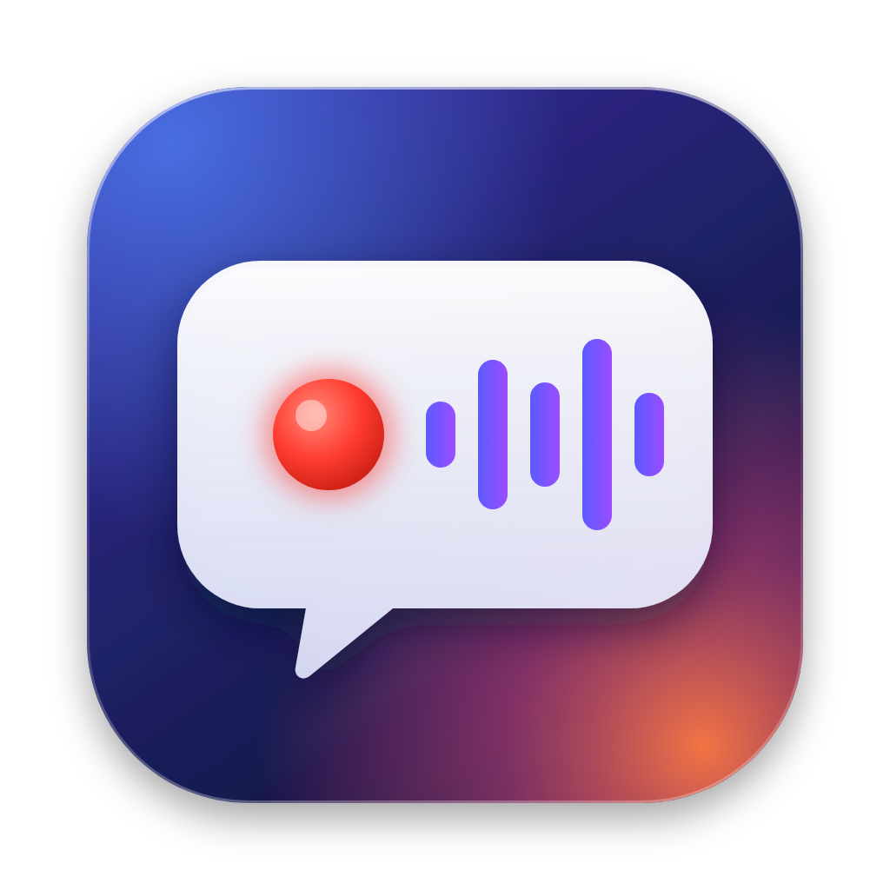
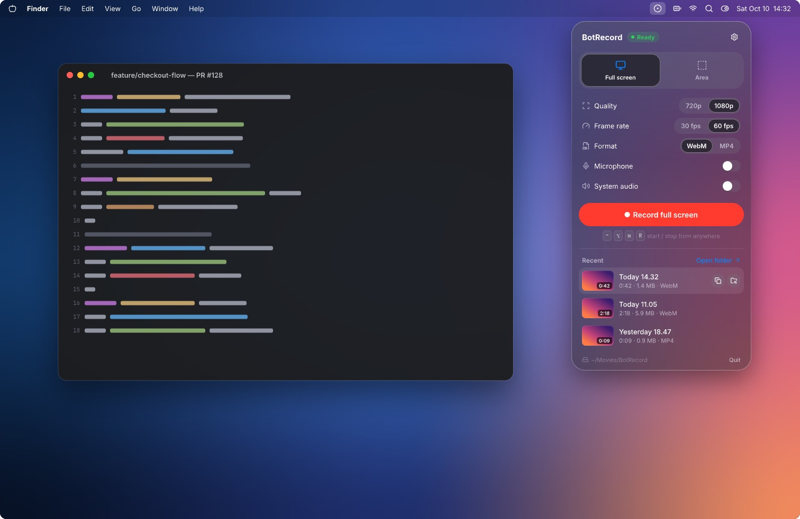
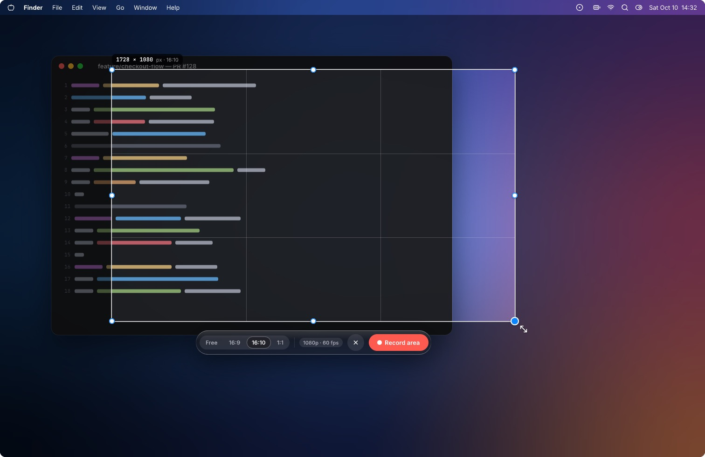
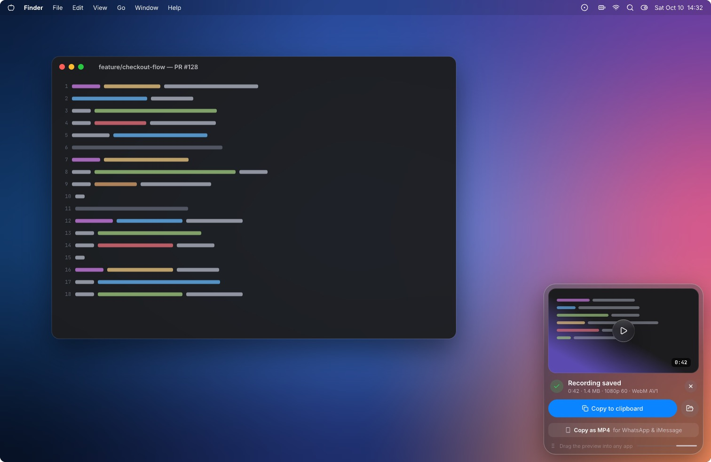
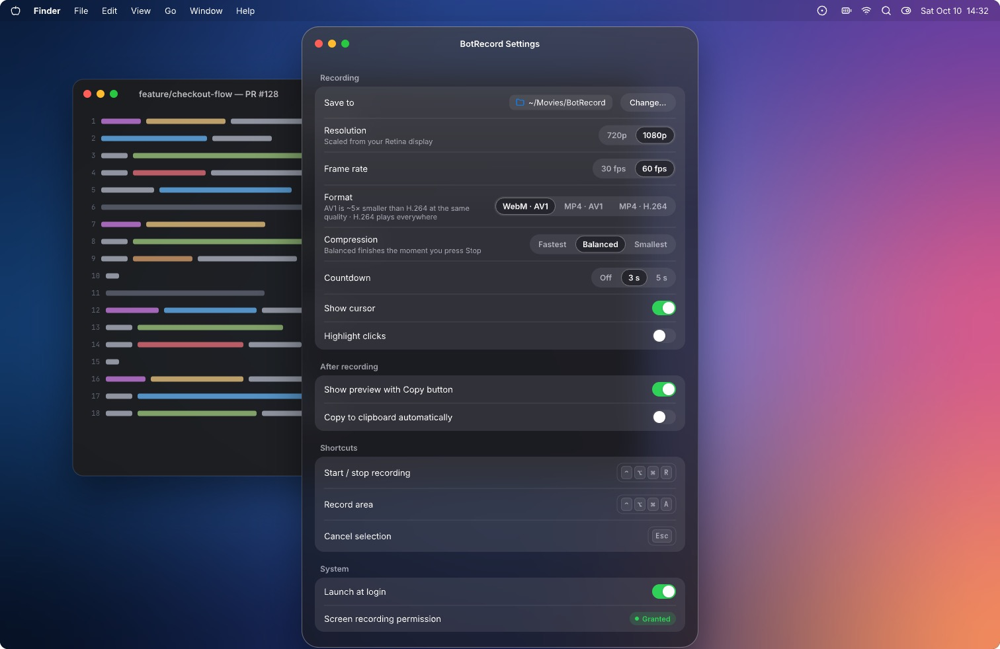

<p align="center"></p>

# BotRecord

**Screen recorder + meeting notetaker for the Mac menu bar.** Record your screen or any call, get a live
transcript made on your Mac, and turn it into a summary with decisions and action items in one click.

<p align="center">
  
  
</p>
<p align="center">
  
  
</p>

- **Record** full screen or an area (720p/1080p, 30/60 fps). Stop → **Copy to clipboard** → paste anywhere.
  WebM·AV1 by default (~5× smaller than H.264) or MP4.
- **Meeting notes** for Discord, Teams, Zoom, Meet or any app: your mic and the call are recorded as separate tracks.
- **Live transcript, 100% on-device** (NVIDIA Nemotron 0.6B on the GPU). Ready the moment you press Stop.
- **One-click summary** (optional) through your own [Claude Code](https://claude.com/claude-code): decisions,
  action items, open questions, plus a running `decisions.md` across meetings.

Requires a Mac with **Apple Silicon** and **macOS 26+**, ~1.2 GB free.

## Install

```sh
git clone https://github.com/octaviusp/BotRecord.git
cd BotRecord
./install
```

About a minute: it downloads the prebuilt app and the speech model from this repo's
[release](https://github.com/octaviusp/BotRecord/releases), checks every SHA-256, installs to
`~/Applications/BotRecord.app`, enables launch at login and opens it. No Xcode, Homebrew or admin password.

**Using an AI agent?** Tell it: *"Install BotRecord following CLAUDE.md in github.com/octaviusp/BotRecord"*.
The [agent procedure](CLAUDE.md#install-botrecord-on-this-mac) does everything except the macOS permission clicks.

## First run

1. Click the **◉** icon in the menu bar (or press **⌃⌥⌘R**).
2. macOS asks once for **Screen & System Audio Recording** (first recording) and **Microphone** (first meeting).
   Allow them; BotRecord guides you and relaunches itself.
3. Optional: click **Connect Claude** in the popover to enable summaries.

| Shortcut | Action |
|---|---|
| ⌃⌥⌘R | Start / stop a screen recording |
| ⌃⌥⌘A | Record an area |
| ⌃⌥⌘M | Start / stop meeting notes |
| Esc | Cancel selection or countdown |

Recordings go to `~/Movies/BotRecord`, meetings to `~/Documents/BotRecord` (one folder each with `transcript.md`,
`summary.md`, `audio.webm`; change both in Settings).

## Update · Uninstall

```sh
git pull && ./install   # update
./uninstall             # removes the app, model, caches and settings; never your recordings or notes
```

## Privacy

Recording and transcription never leave your Mac; no telemetry. Summaries are sent only when you click the button,
through your Claude Code login, with all Claude Code tools disabled.

## Build from source

`brew install svt-av1 opus && scripts/build.sh` → `out/BotRecord.app` (Command Line Tools only). Details in
[CLAUDE.md](CLAUDE.md#development).

MIT licensed. Speech model: NVIDIA Nemotron 3.5 ASR Streaming 0.6B, OpenMDW-1.1. Third-party licenses in
[`THIRD_PARTY_NOTICES.md`](THIRD_PARTY_NOTICES.md).
